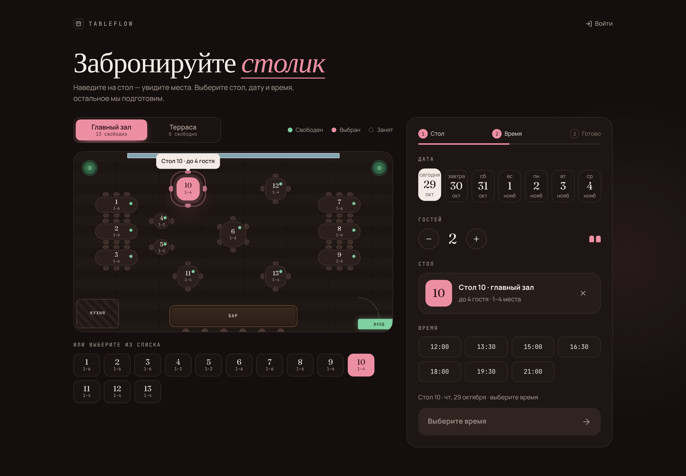
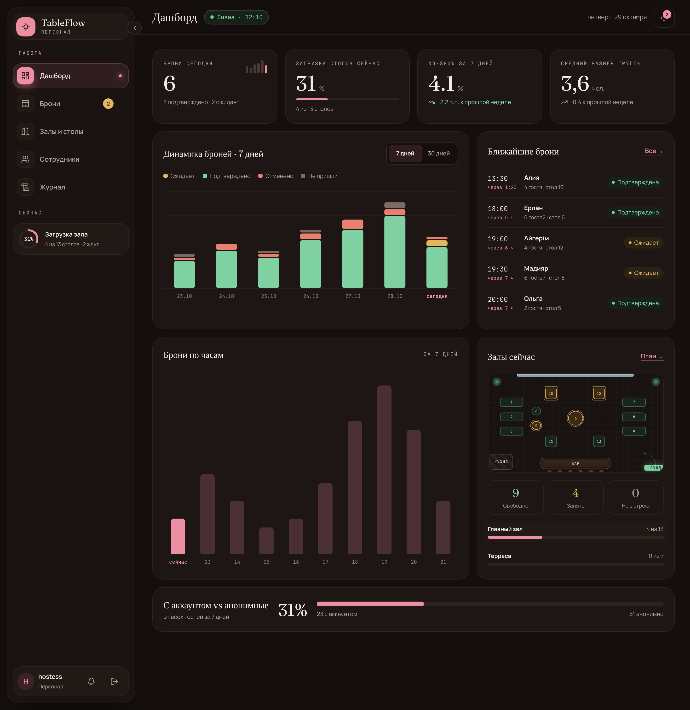
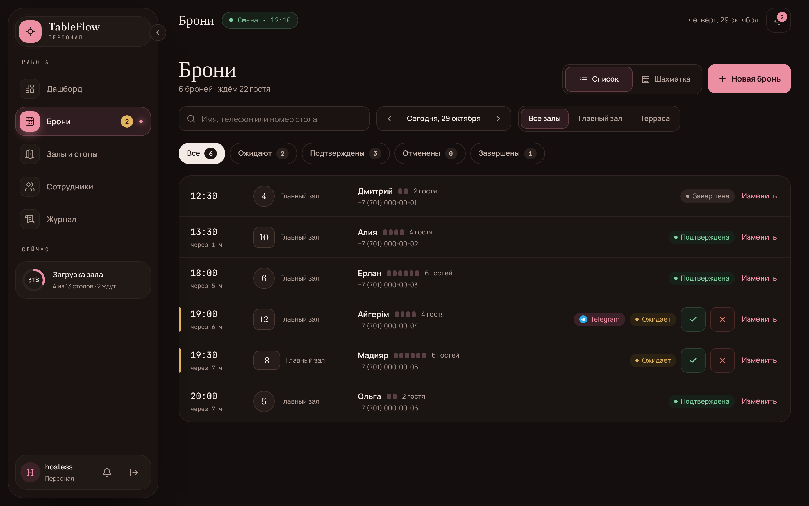
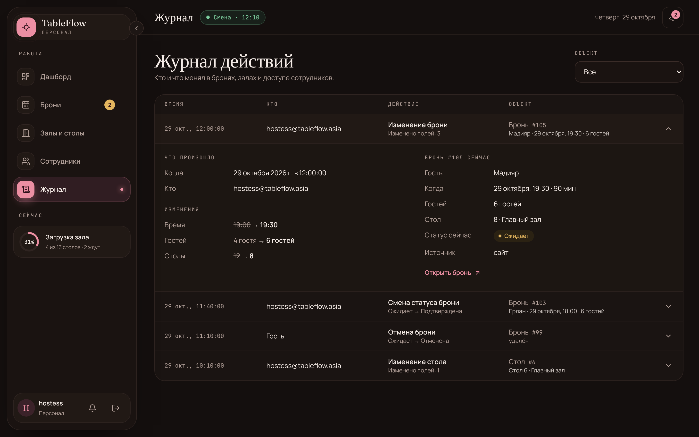
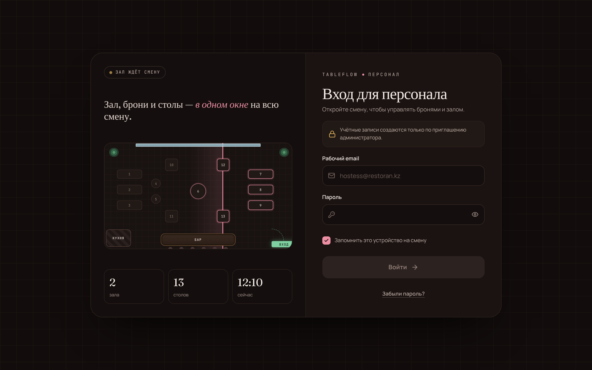

<div align="center">



<br />

[](https://github.com/madyokkaa/TableFlow/actions/workflows/ci.yml)


**[www.tableflow.asia](https://www.tableflow.asia)**

</div>

Гость выбирает стол прямо на схеме зала и бронирует без регистрации — на
сайте или голосом в Telegram. Хостес видит новую бронь в панели в ту же
секунду, подтверждает её одним нажатием, а гость получает ответ.
Двойная бронь невозможна в принципе: это гарантирует база данных, а не
код приложения.

## Возможности

<table>
<tr>
<td width="50%" valign="top">

### 🍽️ Для гостя

- Интерактивная схема зала: стол выбирается кликом по его форме, видно
  бар, вход, окна и другие объекты зала
- Календарь и слайдер времени — занятые слоты затемнены
- Бронь **без аккаунта**; по желанию — вход по паролю или magic-link,
  история броней и отмена
- Обязательное согласие на обработку данных и страница
  [`/privacy`](https://www.tableflow.asia/privacy) с формой удаления данных

</td>
<td width="50%" valign="top">

### 🧑‍🍳 Для персонала

- Список и сетка броней с фильтрами, подтверждение и отмена в один клик
- Редактор схемы зала drag-and-drop в реальном масштабе
- Дашборд: загрузка зала сейчас, динамика, часы пик, ближайшие брони
- Живые обновления через Supabase Realtime и звук новой брони
- Журнал действий: кто, когда и что изменил — «было → стало»
- Управление сотрудниками и доступом

</td>
</tr>
<tr>
<td width="50%" valign="top">

### 🤖 Telegram-бот с ИИ

- Гость пишет или говорит: «Ертең кешкі жетіге төрт адам, атым Айгерім»
- ИИ (Groq) распознаёт речь и извлекает дату, время, гостей и имя на
  казахском, русском и вперемешку
- Бот уточняет недостающее, показывает сводку, берёт телефон из
  контакта Telegram и создаёт бронь
- Подтверждение, отмена, перенос и напоминание за час — в Telegram
- Без ИИ работает базовое решение на правилах

</td>
<td width="50%" valign="top">

### 🛡️ Надёжность и безопасность

- `EXCLUDE`-ограничение Postgres: два гостя не займут один стол на одно
  время; для этого есть нагрузочный тест на 1000 параллельных броней
- Row Level Security на всех таблицах
- Ограничение частоты запросов (IP хранится только как хэш)
- Неизменяемый журнал действий без персональных данных
- CI: lint, типы, тесты, сборка, `npm audit`, gitleaks

</td>
</tr>
</table>

## Скриншоты

<table>
<tr>
<td colspan="2"></td>
</tr>
<tr>
<td width="50%"></td>
<td width="50%"></td>
</tr>
<tr>
<td width="50%"></td>
<td width="50%"></td>
</tr>
</table>

## Как это работает



ИИ в боте делает ровно два шага — распознаёт речь и извлекает поля из
текста. Проверка дат и часов работы, поиск стола, создание брони и
уведомления — обычный код. Модель никогда не пишет в базу и не считает
доступность.

## Стек

| | |
| --- | --- |
| **Фронтенд** | Next.js 16 (App Router), React 19, TypeScript, Tailwind CSS 4, Motion |
| **Бэкенд** | Route Handlers Next.js, Supabase: Postgres, Auth, Realtime, RLS |
| **ИИ** | Groq: `whisper-large-v3` (речь), `openai/gpt-oss-20b` (извлечение полей) |
| **Тесты** | Vitest (unit и интеграционные на тестовом проекте Supabase), Playwright |
| **Инфраструктура** | Vercel (+ Cron), GitHub Actions, Supabase `pg_cron` |

## Быстрый старт

**1. Supabase.** Создайте проект на [supabase.com](https://supabase.com),
скопируйте `.env.example` в `.env.local` и заполните:

```
NEXT_PUBLIC_SUPABASE_URL=          # Project Settings → API
NEXT_PUBLIC_SUPABASE_ANON_KEY=     # Project Settings → API
SUPABASE_SERVICE_ROLE_KEY=         # Project Settings → API (только сервер)
SUPABASE_DB_URL=                   # Database → Connection string → Session pooler (5432)
```

**2. Зависимости и миграции.**

```bash
npm install
npx supabase db push --db-url "$SUPABASE_DB_URL"
```

**3. Демо-данные** (необязательно) — два зала и столы:

```bash
npx tsx scripts/seed.ts
```

**4. Сотрудник.** Создайте пользователя в Supabase (Authentication → Users
→ Add user) и добавьте его в таблицу `staff`. Дальше новых сотрудников
можно приглашать прямо из панели.

**5. Запуск.**

```bash
npm run dev        # http://localhost:3000, панель — /hostess
```

Telegram-бот подключается отдельно — пошагово в
[docs/telegram-bot.md](docs/telegram-bot.md).

<details>
<summary><b>Переменные окружения</b></summary>

<br />

| Переменная | Назначение |
| --- | --- |
| `NEXT_PUBLIC_SUPABASE_URL`, `NEXT_PUBLIC_SUPABASE_ANON_KEY`, `SUPABASE_SERVICE_ROLE_KEY` | доступ к Supabase |
| `SUPABASE_DB_URL` | только локально, для миграций |
| `NEXT_PUBLIC_SITE_URL` | адрес сайта: метаданные, ссылки из бота, вебхук |
| `RESTAURANT_TIME_ZONE` | IANA-пояс ресторана, например `Asia/Almaty` |
| `CRON_SECRET` | защита `/api/cron/cleanup` и `/api/cron/reminders` |
| `TELEGRAM_BOT_TOKEN`, `TELEGRAM_WEBHOOK_SECRET` | Telegram-бот |
| `GROQ_API_KEY`, `GROQ_STT_MODEL`, `GROQ_LLM_MODEL`, `GROQ_STT_PROMPT` | ИИ |
| `AI_BOOKING_ENABLED` | `0` — аварийно выключить ИИ в боте |
| `RESTAURANT_NAME` | название в приветствии бота |
| `NEXT_PUBLIC_OPERATOR_NAME`, `NEXT_PUBLIC_PRIVACY_CONTACT` | страница `/privacy` |
| `RATE_LIMIT_RESERVATIONS`, `RATE_LIMIT_AVAILABILITY`, `RATE_LIMIT_PRIVACY_ERASE`, `RATE_LIMIT_TELEGRAM_CHAT` | лимиты в формате `<запросов>/<секунд>` |

</details>

## Тесты и CI

```bash
npm run lint
npm run typecheck          # next typegen + tsc --noEmit
npm run test:unit          # тесты без базы
npm test                   # все тесты — на ОТДЕЛЬНОМ тестовом проекте Supabase
npm run test:concurrency   # 1000 параллельных броней, только на тестовом проекте
```

GitHub Actions (`.github/workflows/ci.yml`) на каждый pull request и push
в `main`: **lint**, **unit**, **build**, **security** (`npm audit` и
gitleaks) и информационный **integration** на тестовом проекте Supabase.
Вручную запускаются нагрузочный тест (`concurrency.yml`) и замер качества
ИИ (`eval-booking.yml`).

<details>
<summary><b>Какие тесты что проверяют</b></summary>

<br />

| Файл | Supabase | Что проверяет |
| --- | :---: | --- |
| `bookingSlots`, `timeZone`, `floorPlan`, `passwordStrength`, `dashboardLive` | — | слоты, часовые пояса, геометрия зала, пароль, дашборд |
| `aiExtract` | — | ИИ-слой: запрос к Groq, валидация, базовое решение на фразах kk/ru |
| `telegramBot`, `telegramWebhook`, `telegramNotify`, `telegramReminders` | — | диалог бота, вебхук, уведомления, напоминания |
| `rateLimitUnit`, `cronCleanup`, `auditUnit` | — | лимиты, плановая очистка, журнал |
| `reservations`, `hallObjects` | ✓ | API залов, столов и броней, двойная бронь, согласие |
| `audit`, `privacyErase`, `rateLimit`, `telegramBooking` | ✓ | журнал, удаление данных, лимиты, брони из бота |
| `concurrentBooking` | ✓ | 1000 параллельных броней: ровно одна успешная |

Тесты с Supabase создают и удаляют данные, поэтому запускаются только на
отдельном тестовом проекте. Секреты для CI — Settings → Secrets and
variables → Actions: `TEST_SUPABASE_URL`, `TEST_SUPABASE_ANON_KEY`,
`TEST_SUPABASE_SERVICE_ROLE_KEY`, `TEST_SUPABASE_DB_URL`,
`TEST_HOSTESS_EMAIL`, `TEST_HOSTESS_PASSWORD`, `GROQ_API_KEY`.

</details>

<details>
<summary><b>Персональные данные, журнал и плановые задачи</b></summary>

<br />

- **Согласие.** Без отметки о согласии бронь не создаётся; момент
  согласия хранится в `reservations.consent_at`.
- **Удаление по запросу.** Форма на `/privacy` обезличивает закрытые и
  прошедшие брони по email или телефону; будущие брони не трогает.
- **Журнал действий** неизменяем (триггеры запрещают изменение и
  удаление) и не хранит имён, телефонов и email гостей.
- **Очистка** — `GET /api/cron/cleanup` раз в сутки (Vercel Cron):
  закрывает прошедшие брони и удаляет закрытые старше срока хранения.
- **Напоминания за час** — `GET /api/cron/reminders` каждые 10 минут
  через Supabase `pg_cron` (`supabase/manual/schedule_reminders.sql`).
- **Лимиты** — 10 броней и 60 запросов доступности в минуту с одного IP,
  3 запроса на удаление данных в час; ответ `429` с `Retry-After`.

</details>

## Структура проекта

```
app/
  page.tsx                 бронирование для гостя
  account/                 аккаунт гостя: вход, регистрация, история
  hostess/                 панель персонала: брони, залы, сотрудники, дашборд, журнал
  privacy/                 персональные данные и удаление
  api/                     Route Handlers: залы, столы, брони, доступность, журнал,
                           Telegram-вебхук, cron
components/                интерфейс гостя, панели и схемы зала
lib/
  ai/                      Groq, промпт, валидация, базовое решение без ИИ
  telegram/                диалог бота, тексты, уведомления, напоминания
  supabase/                клиенты Supabase
  scheduling.ts, availability.ts, reservations.ts   доменная логика
supabase/migrations/       схема, RLS, RPC — по порядку
tests/                     Vitest: unit и интеграционные
evals/booking/             замер качества ИИ против базового решения
docs/                      документация и картинки README
```

## Деплой

Проект разворачивается на [Vercel](https://vercel.com) с теми же
переменными окружения, что и в `.env.local` (кроме `SUPABASE_DB_URL`).
В Supabase → Authentication → URL Configuration укажите домен сайта,
чтобы ссылки magic-link и сброса пароля вели на него.
